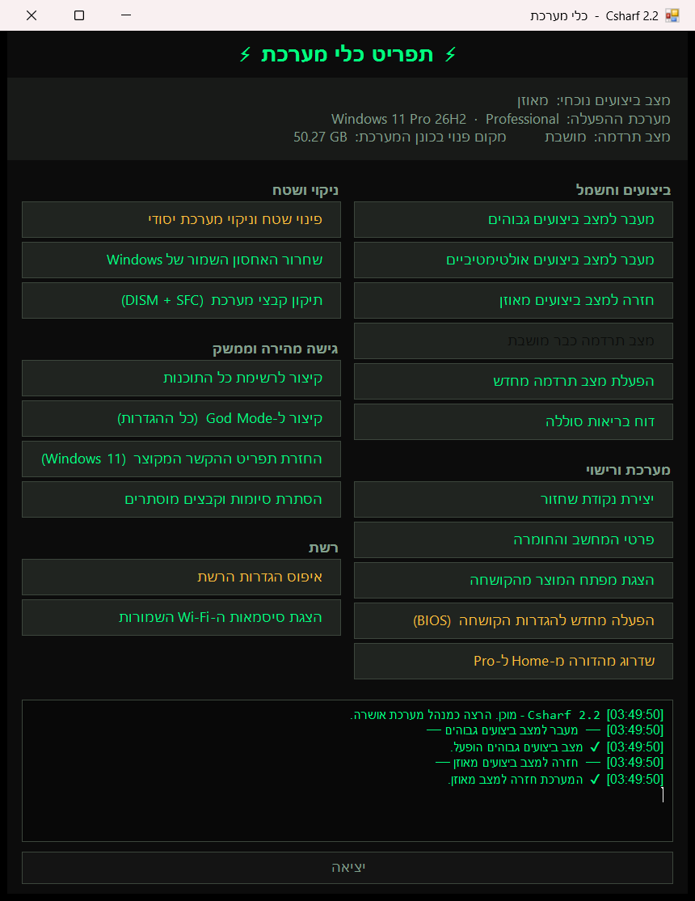
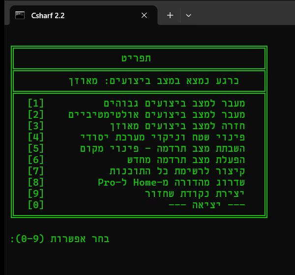

# ⚡ Csharf

**כלי טוויקים ותחזוקה ל-Windows** | בעברית | קובץ אחד | בלי התקנה

> לחיצה כפולה, אישור מנהל אחד — וכל מה ש-Windows מחביא חמישה מסכים עמוק בהגדרות נמצא מולך בחלון אחד.

### [⬇ להורדה — המהדורה האחרונה](https://github.com/BeniaBot/Csharf/releases/latest)

---

## 🖼️ איך זה נראה

וגרסת הקונסולה

---

## 🎯 שתי גרסאות בכל מהדורה

| | **`Csharf.bat`** — ממשק גרפי | **`Csharf-CMD.bat`** — קונסולה |
|---|---|---|
| פעולות | 20, בחמש קבוצות | 9 |
| חלון | ממשק גרפי עם יומן, אחוזי התקדמות וכפתור עצירה | תפריט קלאסי בחלון קונסולה |
| מה זה מריץ | batch + PowerShell | batch (ו-PowerShell לנקודת שחזור, כשהוא זמין) |
| מתאים ל | רוב המחשבים | מחשב שבו PowerShell חסום, או למי שאוהב קונסולה |

מורידים אחד מהשניים, לוחצים לחיצה כפולה, ומאשרים פעם אחת את בקשת הרשאות המנהל.

---

## 🛠️ מה יש בפנים

* **ביצועים וחשמל** — מצב ביצועים גבוהים, אולטימטיבי או מאוזן · השבתה והפעלה של מצב תרדמה · דוח בריאות סוללה
* **ניקוי ושטח** — פינוי שטח יסודי · שחרור האחסון השמור של Windows (כ-7GB) · תיקון קבצי מערכת ב-DISM ו-SFC
* **גישה מהירה וממשק** — קיצור לרשימת כל התוכנות · קיצור ל-God Mode · תפריט ההקשר המלא של Windows 10 ב-Windows 11 · הצגת סיומות וקבצים מוסתרים
* **רשת** — איפוס הגדרות הרשת · הצגת סיסמאות ה-Wi-Fi השמורות
* **מערכת ורישוי** — נקודת שחזור · פרטי המחשב והחומרה, כולל מספר סידורי · מפתח המוצר שצרוב בקושחה · הפעלה מחדש ישר להגדרות הקושחה · שדרוג מהדורה מ-Home ל-Pro

בקונסולה: ביצועים גבוהים, אולטימטיבי ומאוזן · פינוי שטח · השבתה והפעלה של מצב תרדמה · קיצור לרשימת כל התוכנות · שדרוג ל-Pro · נקודת שחזור.

---

## 🛡️ בנוי לא להזיק

* **ניקוי שעושה רק את הבטוח** — קבצים זמניים, סל המיחזור, יומנים ועדכונים ישנים. `Windows.old` נמחק רק אחרי שאלה נפרדת, היסטוריית הקבצים לא נוגעת, ועדכוני Windows עדיין ניתנים להסרה.
* **שואל לפני כל דבר שקשה להחזיר** — ניקוי, איפוס רשת, שדרוג מהדורה, הפעלה מחדש של המחשב או של סייר הקבצים.
* **אפשר לעצור** — תיקון קבצי מערכת, ניקוי ושאר הכלים הארוכים נעצרים מהכפתור התחתון, שמראה גם כמה זמן עבר וכמה אחוזים נשארו.
* **לא משאיר אחריו זבל** — תוכנית חשמל אחת בלבד, ו"חזרה למאוזן" מנקה גם את מה שגרסאות קודמות השאירו.
* **אומר את האמת** — בסוף כל פעולה כתוב אם היא הצליחה, נכשלה או בוטלה.

---

## ⚠️ על שינוי המהדורה ל-Pro

משתמש ב**מפתח הגנרי הפומבי של מיקרוסופט**, ופועל רק על מהדורת Home.
הפעולה **משנה את המהדורה בלבד — היא לא מפעילה רישיון (Activation).** אחרי ההפעלה מחדש עדיין נדרש רישיון Pro תקף או זכאות דיגיטלית.

## 💻 תאימות

**Windows 10/11, כל המהדורות.** הגרסה הגרפית דורשת PowerShell 3.0 ומעלה, מובנה מ-Windows 8. הקונסולה לא דורשת כלום מעבר ל-cmd.

חלק מהפעולות קיימות רק בחלק מהמחשבים — תפריט ההקשר הוא Windows 11 בלבד, הכניסה להגדרות הקושחה דורשת מחשב UEFI, ונקודת שחזור לא קיימת ב-Windows Server. מה שלא רלוונטי מסומן באפור או מדולג עם הסבר, בלי לקרוס.

> 📌 **בקיצור:** קובץ אחד, בלי התקנה, בעברית שנקראת נכון — שעושה רק מה שביקשת, ואומר לך בדיוק מה קרה.

---

🔧 למפתחים — למה זה בנוי ככה, ואיך בודקים

### מבנה

**הגרסה הגרפית** היא batch ו-PowerShell באותו קובץ. ה-batch מחלץ את קטע ה-PowerShell, מריץ אותו מוסתר ויוצא מיד; ה-PowerShell מבקש הרשאות פעם אחת ומציג WinForms. הסיבה היא ש-WinForms תומך ב-`RightToLeft` אמיתי, כך שהעברית נכתבת בסדר לוגי רגיל ונקראת נכון.

**הקונסולה** לא יכולה להישען על זה, כי לקונסולה אין bidi — היא מציירת תווים משמאל לימין לפי סדר האחסון. לכן העברית שם שמורה ב**סדר ויזואלי**, והקובץ שמור ב**קוד דף 862** (עברית OEM).

הקידוד הוא לא רק עניין של גופן: cmd עוקב אחרי היסט בייטים בקובץ ה-bat בזמן שהוא מפענח אותו, ו-UTF-8 רב-בייטי מוציא אותו מסנכרון עד שהוא מתחיל להריץ אמצע שורות כפקודות. ב-CP862 כל אות עברית היא בייט אחד, וההיסט נשאר תקין.

היפוך ידני של טקסט הוא מה ששיבש גרסאות קודמות של הכלי, ולכן `tools/build-cmd.ps1` כתוב בעברית לוגית רגילה וממיר לסדר ויזואלי מכנית, כולל היפוך סוגריים. **לערוך את הגנרטור, לא את ה-bat.**

בקשת ההרשאות של הקונסולה עוברת דרך VBS ו-`cscript`; ב-Windows שבו VBScript כבר הוסר, היא נעזרת ב-PowerShell. חלון המנהל נפתח דרך `conhost.exe` עם גופן שיש בו אותיות עבריות (Courier New), שנקבע במפתח רישום זמני שנמחק מיד אחרי שהחלון נפתח — כך העברית לא מתפרקת לאותיות. נקודת השחזור נוצרת ב-`Checkpoint-Computer` של PowerShell, כמו בגרסה הגרפית, ו-VBS משמש רק כשאין PowerShell.

> **לעורכים את `Csharf.bat`:** החלק העליון, עד שורת הסימון שלפני קטע ה-PowerShell,
> חייב להישאר ASCII בלבד — מאותה סיבה בדיוק. הקובץ נשמר כ-UTF-8 **בלי BOM**
> (אחרת `@echo off` עצמו נשבר) ועם סיומות שורה של Windows. `.gitattributes` מסמן
> `*.bat -text` כדי ש-git לא ינרמל שורות ויפגע בשני הקבצים.

### בדיקות

`tools/` כולל בדיקות שמריצות את הקוד האמיתי של שתי הגרסאות, בלי בקשת הרשאות (להריץ מ-PowerShell **רגיל**, לא כמנהל):

| | מה נבדק |
|---|---|
| `test-gui.ps1` + `hooks/layout.ps1` | החלון בכמה גדלי מסך והגדלות תצוגה, כולל מדידת פיקסלים של יישור הטקסט |
| `test-gui.ps1` + `hooks/stop.ps1` | עצירת פעולה ארוכה, פעולות שאסור לעצור, נתיבים עם רווחים |
| `test-gui.ps1` + `hooks/progress.ps1` | אחוזי ההתקדמות של DISM ו-SFC |
| `test-gui.ps1` + `hooks/toggles.ps1` | כפתורים שמראים מצב, ושאלה לפני הפעלה מחדש של הסייר |
| `test-gui.ps1` + `hooks/additions.ps1` | פרטי המחשב והכניסה להגדרות הקושחה |
| `test-gui.ps1` + `hooks/power.ps1` | תוכניות החשמל — **משנה את המחשב, לגבות קודם** |
| `test-launch.ps1` | בקשת הרשאות אחת גם בהפעלה כפולה |
| `test-cmd.ps1` | הפעולות של הקונסולה — **משנה תוכניות חשמל, לגבות קודם** |
| `test-cmd-elevation.ps1` | הדרך של הקונסולה לחלון המנהל, מתיקייה עם עברית, רווח וסוגריים |
| `test-admin.ps1` | מה שדורש הרשאות מנהל: נקודת שחזור אמיתית בשתי הגרסאות (מבקש אישור אחד) |

גיבוי תוכניות החשמל: `reg export "HKLM\SYSTEM\CurrentControlSet\Control\Power\User\PowerSchemes" backup.reg`

צילומי המסך שבדף הזה נוצרים מאותו קוד: `test-gui.ps1` עם `hooks/screenshot.ps1`, ו-`shoot-console.ps1`.

## רישיון

[MIT](LICENSE) — מותר להשתמש, לשנות ולהפיץ, בתנאי שמשאירים את הודעת זכויות היוצרים.
